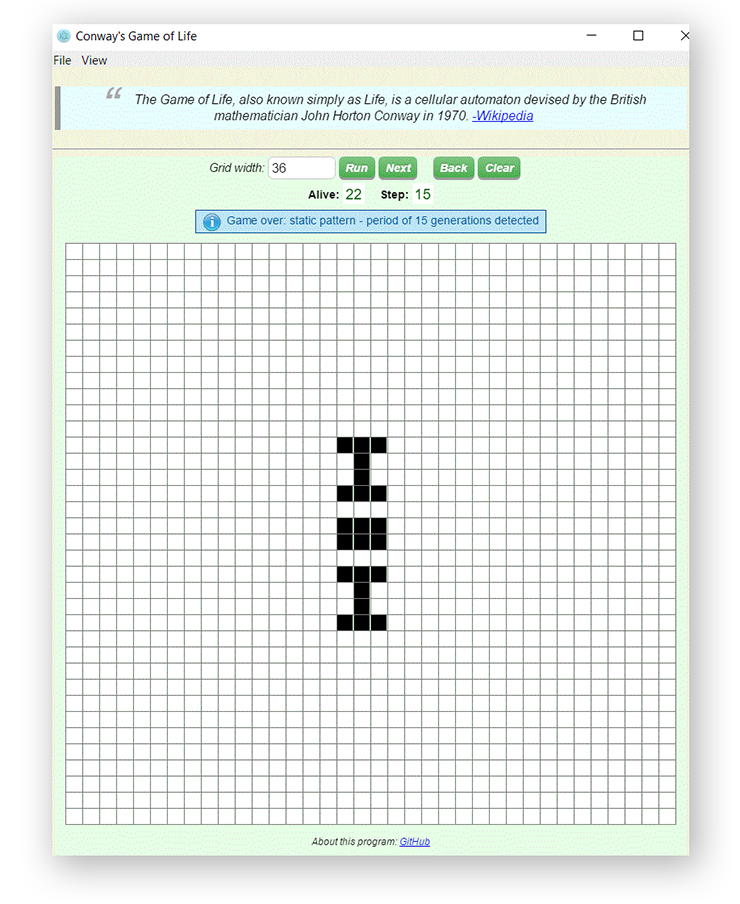

# electron-game-of-life
Conway's Game of Life using Electron framework

This is a simple application showing various aspects of writing
desktop apps using Electron/HTML5/CSS/NodeJS/Javascript.

### Screen capture:



## Motivation
I wrote this as an exercise inspired by an excellent tutorial by Lea Verou [Play by Play](https://www.pluralsight.com/courses/play-by-play-lea-verou).

## Features
* Auto-run or step-by-step
* Back step history (up to 1000 steps)
* Auto detection of still life and oscillators
* Change grid size at any time
* Save and load grid configuration (JSON text format)
* Works on Windows, macOS and Linux

## Install and Run
Requires Node.js (the version of Node bundled with your installed Electron is used at runtime; for `npm install` any reasonably modern Node will work).

```
npm install
npm start
```

If you are new to Electron, see the [Quick Start](https://www.electronjs.org/docs/latest/tutorial/quick-start).

## Architecture and security

The renderer process runs locked down following current Electron security recommendations:

* `contextIsolation: true`, `nodeIntegration: false`, `sandbox: true` — the renderer cannot `require()` Node modules.
* A `preload.js` script exposes a narrow API to the renderer via `contextBridge.exposeInMainWorld('electronAPI', { ... })`.
* All file I/O (`fs.readFile`/`fs.writeFile`) and external link opening (`shell.openExternal`) happen in the main process, behind `ipcMain.handle` endpoints with argument validation. External links are restricted to `http(s)://`.
* A strict Content-Security-Policy is set in `index.html`; there are no inline `<script>` blocks.
* `will-navigate` and new-window handlers prevent the renderer from navigating away from the local `file://` page.

### File layout

| File | Role |
|---|---|
| `main.js` | Main process: window creation, menu, IPC handlers for dialogs / file I/O / external links. |
| `preload.js` | Runs in renderer context before page scripts; uses `contextBridge` to expose `window.electronAPI`. |
| `index.html` | UI markup + CSP. Loads renderer scripts via `<script src>`. |
| `scripts/game_of_life.js` | Game logic and UI (renderer). |
| `scripts/ex-links.js` | Routes outgoing `http(s)` links through `electronAPI.openExternal`. |

## Distribution
To package the app into a stand-alone for distribution, use [@electron/packager](https://github.com/electron/packager) (formerly `electron-packager`).

### For Windows
From the project folder:

```
npm install
npx @electron/packager . --platform=win32 --arch=x64
```

This creates a `game-of-life-win32-x64` folder containing `game-of-life.exe` along with the DLLs and resources needed to run the app stand-alone.


## License

[MIT](LICENSE)
